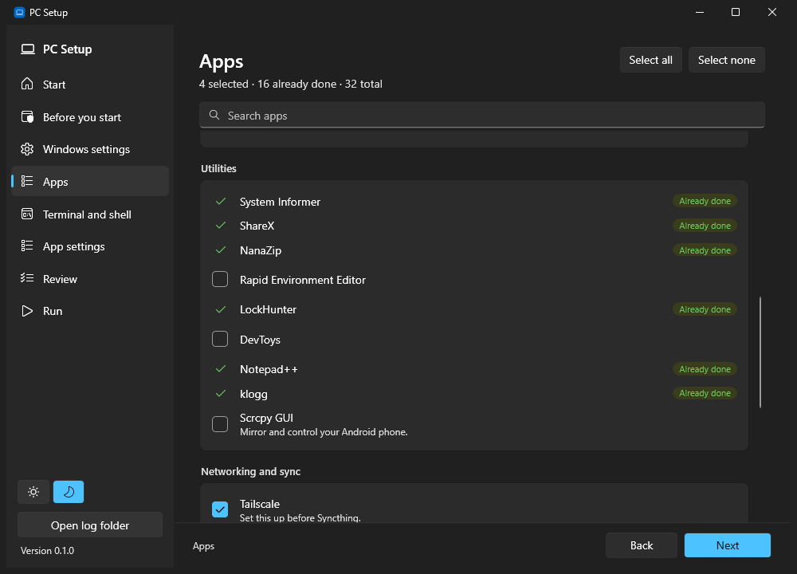
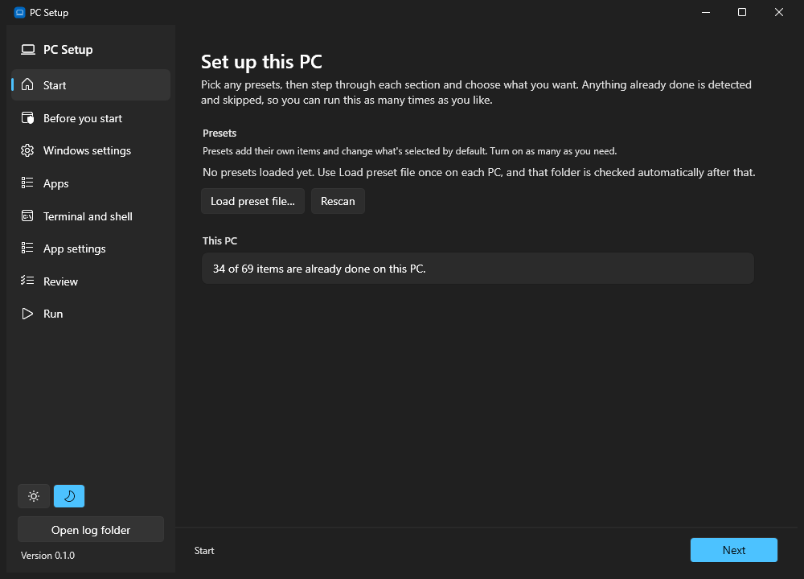
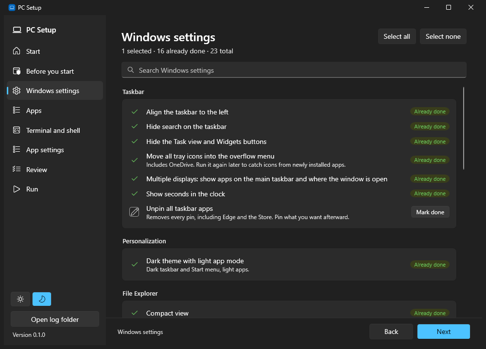
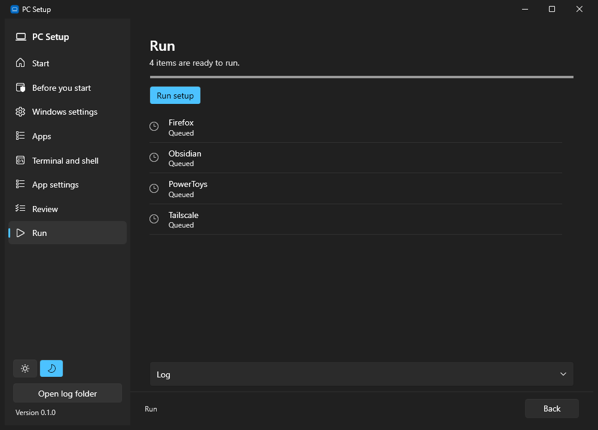

# PC Setup

A Windows app that steps through setting up a PC: Windows settings, silent app installs, and a checklist of manual steps. Every item checks whether it's already done, so you can run it as many times as you like and only pick up what's missing.



| Start | Windows settings | Run |
| --- | --- | --- |
|  |  |  |

## Run it

From any PowerShell window:

```powershell
irm pc.micahmo.com | iex
```

`pc.micahmo.com` redirects to the script in this repo; the full address works too:

```powershell
irm https://raw.githubusercontent.com/micahmo/pc-setup/main/go.ps1 | iex
```

This downloads the latest release to `%LOCALAPPDATA%\PCSetup\app`, replacing any older copy, and starts it. The app asks for admin rights.

Logs are written to `Documents\PC Setup\logs`, one file per run. The app's **Open log folder** button opens it.

## How it's organized

| Path | What it is |
| --- | --- |
| `catalog/*.yaml` | Everything the app can do. Files load in name order; each file sets a default `section` (wizard step) and `category` (group heading). |
| `pcsetup.yaml` | Wizard step order and extra folders to search for presets. |
| `presets/*.yaml` | Public presets shipped with the app (optional). |
| `private/` | Gitignored. Backup copies of private presets; the real ones live outside the repo. |
| `src/PCSetup` | The WPF app (.NET 10). |
| `go.ps1` | The one-line bootstrap. |

## Catalog items

An item's kind comes from which fields it has.

```yaml
# winget app
- id: firefox
  name: Firefox
  category: Browsers
  winget: Mozilla.Firefox
  # default: true         # optional: start selected. Nothing in this catalog does; you pick, or a preset does.
  # optional: source: msstore, scope: machine, wingetArgs: "--override ..."

# registry settings (checked and applied without PowerShell)
- id: explorer-extensions
  name: Show file extensions
  restart: explorer        # none | explorer | signout | reboot
  registry:
    - path: HKCU\Software\Microsoft\Windows\CurrentVersion\Explorer\Advanced
      name: HideFileExt
      value: 0             # type defaults to DWord; also QWord, String, ExpandString, Binary
      # delete: true       # remove the value instead

# PowerShell script
- id: screen-timeout-never
  name: Never turn off the screen
  detect: |                # return $true when it's already done
    powercfg /query SCHEME_CURRENT SUB_VIDEO VIDEOIDLE | Select-String '0x00000000'
  apply: |
    powercfg /change monitor-timeout-ac 0

# manual step (no apply). Shows instructions and an Open button.
- id: static-ip
  name: Set a static IP address
  instructions: Open the adapter's properties...
  open: ncpa.cpl           # URL, ms-settings: link, folder, or program
  detect: |                # optional, but worth adding: the step then ticks itself off
    Get-NetIPInterface -AddressFamily IPv4 | Where-Object Dhcp -eq Disabled
```

Manual steps have no checkbox and never run. Do them from their page with **Open**, then **Mark done** ("Marked done", remembered on that PC; **Undo** puts it back), or let their `detect` tick them off ("Already done").

Any desktop shortcut an install creates is removed right after it, on your desktop and the Public desktop. Shortcuts that were already there are left alone.

Other fields, on any item:

- `description`: a line under the name.
- `dependsOn: [id, ...]`: runs after those items, and waits if they aren't done. A settings item that depends on an app also gets a reminder on the Review page when you install the app without selecting it (or, for a manual step, without having done it).
- `requires: { test: <PowerShell>, hint: <text> }`: a precondition checked right before applying, such as a synced folder existing. If it fails, the item shows as "Not ready" with the hint and a Retry button.
- `order`: lower runs first (default 50). Cleanup like deleting desktop shortcuts uses 90 so it follows the installs.
- `once: true`: a fresh-PC step, like unpinning everything. After it runs, or you select **Mark done**, it stays done on that PC ("Done before") even if its check would fail later, for example when you pin an app on purpose. **Undo** makes it runnable again.
- `detect` on a winget item overrides the winget check, for apps that can also arrive another way.

Scripts run in Windows PowerShell 5.1, elevated, with `$ErrorActionPreference = 'Stop'`. A script that tries to prompt fails rather than hanging. After every apply the app runs the check again, so "Done" always means verified.

## Presets

A preset is an optional layer over the catalog:

```yaml
name: Work dev box
description: Shown on the Start page.
section: Work               # default step for this preset's own items
select: [vpn-client]        # items to start selected, from the catalog or this preset ("*" for everything)
deselect: [freetube]        # catalog items to turn off
items:                      # extra items, same format as the catalog
  - id: join-domain         # an id that matches a catalog item replaces it
    ...
```

Presets are found in the app's `presets` folder and in any folder you've loaded one from. **Load preset file…** remembers that folder on that PC (in `%LOCALAPPDATA%\PCSetup\settings.yaml`, not the repo), so after the first time, presets there show up on their own. Use **Rescan** to pick up new or newly synced files. Turn on as many as you need. Only the items in a preset's `select` list start selected, including the preset's own items.

Anything with work details (domains, tenant IDs, internal links) belongs in a private preset, never in this repo.

**Save selections as preset…** on the Review page writes the current choices to a preset file, so the next PC is "load preset, run".

## Releasing

Edit the catalog, commit, then tag:

```powershell
git tag v0.2.0
git push origin v0.2.0
```

The Release workflow builds a self-contained single-file exe, zips it with the catalog, and publishes it as the latest release. That's what `go.ps1` downloads.

## Developing

```powershell
dotnet build src/PCSetup/PCSetup.csproj
```

The catalog and `pcsetup.yaml` are copied next to the exe on build, so editing the YAML and rebuilding is enough to try a change.
